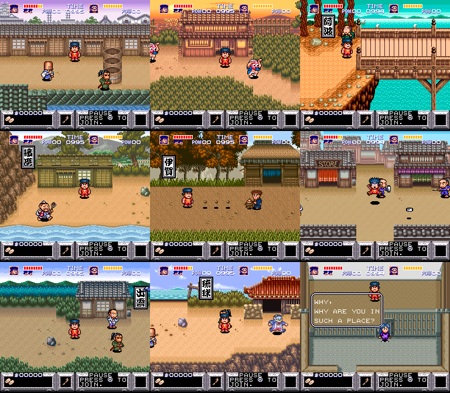
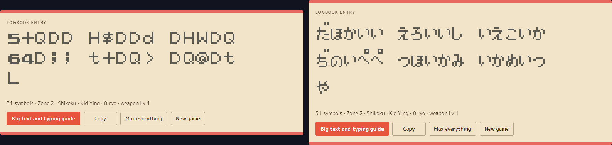
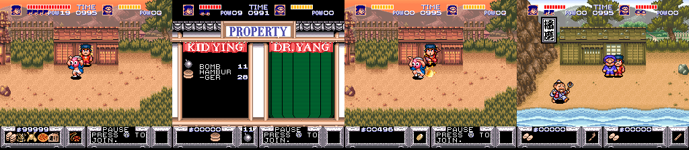

# The Legend of the Mystical Ninja — Password Generator & Secrets

**[Open the password generator →](https://maxxthunder.github.io/mysticalninja/)** &nbsp; 

- **Make a logbook** for any zone, with any ryo, lives, health, POW, bombs, weapon, jutsu, armor, food and key items.
- **Decode a logbook** you already have to see what it holds, and fix typos.
- **Two players:** 7- and 55-symbol logbooks hold Kid Ying and Dr. Yang together. A 31-symbol logbook can also hold Dr. Yang alone, which the game writes after Kid Ying's game over.
- **Glitch mode** for values past the game's own limits, like the coin-throw weapon.
- **Japanese release:** a Game version switch shows and reads logbooks in kana (Japan 1.1–1.2, or 1.0), drawn in the game's own kana font.
- **Typing guide:** a big-text view with the entry screen's grid, the next symbol lit and the button presses to reach it.
- **See what each symbol holds:** point at a symbol to see its fields, or at a control to see its symbols. Each player card shows a live copy of the in-game HUD.

Everything here comes from disassembling the ROM, and **every code below was loaded in an emulator (Mesen 2)** with its effect checked in RAM or on screen. The decoder was also fuzzed against the game's own: of 1,557 logbooks typed into the real entry screen, the game accepted exactly the 13 the generator accepts ([details](docs/secrets.md#fuzz-check-against-the-real-decoder)).

The US, US Virtual Console, European and German releases all take the same logbooks, and the Japanese 1.1 and 1.2 take them in kana ([Regions](#regions)).

## How to use a logbook

1. On the title screen, choose **CONTINUE**, then **FROM LOGBOOK ENTRY**.
2. Type the symbols: B types one, Y deletes. Upper and lower case are different symbols, and there's no O or I. The generator's decoder fixes common mix-ups like o/0, I/l and K/k.
3. Move to **END** and press B.

On the Japanese release: choose **つづきをあそぶ**, then **たびにっきを つけたところから**. B types a kana, A or Y deletes, and **おわり** ends. Set the page's Game version to Japan 1.1–1.2 or Japan 1.0 first. Short codes work on every revision; if a full logbook fails, try the other Japanese setting.

A full logbook (31 symbols, 55 for two players) holds everything. A short one (6 or 7) also stores the four jutsu, but the game clears them as the zone starts, so only the zone counts.

## Logbook codes

**★ New** means the code wasn't listed before (GameFAQs only had the zone codes and three stocked logbooks). **Fixed** means it was posted with a typo the game rejects; the working version is given. **Known** codes work as posted.

| Code | Starts in | Effect | Status |
|---|---|---|---|
| `MRbjh j` | Zone 1 · Edo | Short code | Known |
| `#rM/B /` | Zone 2 · Shikoku | Short code | Known |
| `8hXw0 w` | Zone 3 · Awa | Short code. Posted as `8hXwow`: the game has no o, it's a zero | Fixed |
| `W:3LN L` | Zone 4 · Harima | Short code | Known |
| `k=bPb R` | Zone 5 · Iga | Short code. Posted with a capital K, which fails | Fixed |
| `1tL<H <` | Zone 6 | Short code. Posted with a lower-case l, which fails the checksum | Fixed |
| `/j#2△ 2` | Zone 7 · Izumo | Short code, the one zone missing from the posted list | ★ New |
| `"?kk5 k` | Zone 8 · Ryukyu | Short code. Posted as `''?kk5k`: the two quote marks are one `"` symbol | Fixed |
| `&xT>X >` | Zone 9 · barred prison cell | Short code; opens with a short scene. `H-WNxN`, posted as "Final Level", does the same | Known |
| `8#4V7 LprBy 4v52B j@7-T YM?0P 7/4By ;` | Zone 9 · white cell | Last level, fully stocked: full health, weapon level 3, all jutsu. Hit the white cell wall until a door opens | Known |
| `♡63>△ :tH!8 d%W!L 1G△4M dTH6Q △>HLw W` | Zone 8 · Ryukyu | Second-to-last level, fully stocked. The posted one fails the checksum; a capital W is the likeliest misread, but other one-symbol fixes also pass | Fixed |
| `vxZ++ lh:@Y nn3+! $T+KK hG:!< +!+X@ r` | Zone 3 · Awaji theme park | "Unlimited hamburgers": 128 of them ([how they work](#hamburgers)). Posted with a capital I; it's a lower-case l | Fixed |
| `b!DQQ TnQhT QThQD z♡Q99 1!QD△ RBQQv M` | Zone 2 | 255 hamburgers, the most the field holds | ★ New |
| `b!DQQ Z%$"R t<5JB y+J-- 04N?+ vkJl< J` | Zone 2 | Max kit: 99,999 ryo, POW 19, 39 bombs, all jutsu, 255 of every helmet, armor and whole pizza, every key item | ★ New |
| `b!DQQ TNQDV N>lQD z♡Q99 1!QD△ QDN+8 Y` | Zone 2 | Weapon level 4: the attack throws coins, and each throw costs ryo | ★ New |
| `:jH20 4;` | Zone 4 | Two players, short code | ★ New |
| `lj/N0 <♡kM2 %mvyM Kh0>$ JV/Yb 0r%♡7 0kM/% #ryNg 0t901 v/l♡0 1=♡Wt` | Zone 9 · white cell | The "Last level" kit for both players | ★ New |
| `%>H3H mq△dW L!D@d &"Hp/ w>$>+ HTLdJ Q` | Zone 9 · white cell | The "Last level" kit with zone 8½ selected: there's no zone 8 start, so it starts where zone 9 does | ★ New |

Codes that start "Zone 2" are full logbooks set to zone 1: the game moves a zone 1 logbook to zone 2. Type △ and ♡ where shown; GameFAQs writes them ¥ and ¢.

### What "unlimited hamburgers" really does

Pizza, pizza slices and hamburgers save you from dying. When your health hits 0, the game eats a whole pizza (full heal) if you have one, else a slice (+6 health), else a hamburger (+4), and you don't lose a life (`$05:A56B`). The GameFAQs code gives 128 hamburgers. In the emulator each death took the count 128 → 127 → 126 and gave back 4 health, with lives unchanged. The PROPERTY screen only prints two digits, so 128 shows as "28". The field holds up to 255.

### Glitch values

Apart from the zone (below 10) and the story step (below 8), the game doesn't range-check anything in a logbook. Glitch mode in the generator unlocks these:

| Value | What happens |
|---|---|
| Weapon level 4 | A gold coin in the weapon box. The attack throws coins and each throw costs ryo (500 → 476 over a few dozen throws). |
| Max health 17–31 | A health bar up to twice the normal length. The game's own cap is 16 (8 at the start, +2 per tour package), and it goes back to 8 at the next zone. |
| POW 11–19 | Jutsu uses past the game's cap of 10. |
| Bombs 31–39 | Past the game's cap of 30. |
| Lives 10–15 | The HUD still draws 4 heads. |
| 100–255 of an item | Works; the PROPERTY screen shows only the last two digits. |
| Zone 8 | There's no zone 8 start point. A short code freezes on a black screen; a full logbook starts where zone 9 does. |
| Hex digits in ryo, POW, POW pieces or bombs | These are stored as decimal digits; A–F draw as junk tiles. Only reachable by decoding a crafted logbook. |

### Other places we looked

- **Button codes:** every table of button presses in the ROM is animation or input-mapping data. There's no title-screen or pause cheat code.
- **Text:** the game's text is plain ASCII. A full dump turned up no developer messages, only the romaji room names of the debug menu below.
- **Debug menus:** two are left in the ROM, and neither can be reached in play. A room-select menu opens with Up on controller 2, but only in an unused zone 1 test room. A zone, area and story select has no code calling it. ([details](docs/secrets.md#debug-leftovers-and-unused-text))

## What the logbook holds

| Field | Notes |
|---|---|
| Zone | 0–9 in the logbook, shown as zones 1–9 (there's no zone 8 start point) |
| Ryo | Up to 99,999, stored as decimal digits |
| Lives | The HUD draws at most 4 heads. At 0 the next death is game over |
| Health, max health | In half hearts. Max health starts at 8, +2 per tour package up to 16, and resets to 8 at every new zone |
| POW | Jutsu uses; each jutsu costs 1. Capped at 10 |
| POW pieces | Every 10 pickups turns into 1 POW |
| Bombs | Capped at 30 |
| Weapon | Levels 1–3. You drop a level every time you're hit |
| Jutsu 1–4 | The four boxes on the pause screen. Cleared at every new zone |
| Gold helmet, iron helmet, straw hat, gold armor, chain armor, straw coat | Durability, not a count: armor soaks each hit's damage. PROPERTY shows durability ÷ 8 (gold), 6 (iron, chain) or 4 (straw), rounded up |
| Straw sandals | Speed. More than 3 doesn't make you faster; you lose one when hit |
| Pizza, pizza slice, hamburger | Eaten automatically when health hits 0 ([above](#hamburgers)) |
| Pass, text, elephants 1–4 | Key items, cleared at every new zone. NPCs check the text. Elephants 1–3 are checkpoints in zones 4–9: lose a life in the action stage and "WHERE DO YOU WANT TO CONTINUE." lets you restart at any you hold (checked in Mesen). Set them in a logbook to start with every checkpoint. Elephant 4 does nothing |
| Story step | Where the plot is inside the zone. It doesn't change where a logbook starts (checked 0-7 in every zone); in zone 9, 6 and 7 crash the game |

A fresh 1P game starts with 0 ryo, 0 POW, 0 bombs, 2 lives and 8 max health.

## Regions

| Release | Logbooks | Notes |
|---|---|---|
| Super Nintendo, US | Same | The ROM everything here was taken from |
| Super Nintendo, US (Virtual Console) | Same | Identical code; 7 bytes of palette data changed |
| Super Nintendo, Europe | Same | Same routines and tables, one byte further along in the ROM |
| Super Nintendo, Germany | Same | Same routines; tables moved but identical. German menus (WEITER → VON LOGBUCHEINTRAG) |
| Super Famicom, Japan 1.1 and 1.2 (and 1.2 Virtual Console) | Same values, kana symbols | US `B` is あ, and so on; the table is in [docs/secrets.md](docs/secrets.md#japan-ganbare-goemon-yuki-hime-kyuushutsu-emaki) |
| Super Famicom, Japan 1.0 | Short codes the same; full logbooks differ | Different keys at 7 of the data symbols |

### Codes in kana

Short codes are the same on every Japanese revision. The full logbooks below were loaded in Mesen in the versions shown.

| Code (Japan) | US code | Starts in |
|---|---|---|
| `ゆきさそせそ` | `MRbjhj` | Zone 1 · Edo |
| `れちゆぴあぴ` | `#rM/B/` | Zone 2 · Shikoku |
| `でせらとなと` | `8hXw0w` | Zone 3 · Awa |
| `こぷねやよや` | `W:3LNL` | Zone 4 · Harima |
| `がまさわさき` | `k=bPbR` | Zone 5 · Iga |
| `につやぽえぽ` | `1tL<H<` | Zone 6 |
| `ぴそれぬふぬ` | `/j#2△2` | Zone 7 · Izumo |
| `ひむががだが` | `"?kk5k` | Zone 8 · Ryukyu |
| `ぞざくみらみ` | `&xT>X>` | Zone 9 · barred prison cell |
| `ぷそえぬなのぺ` | `:jH204;` | Zone 4, two players |
| `でれのけづ やごちあじ のてだぬあ そめづぱく りゆむなわ づぴのあじ ぺ` | Last level | Zone 9 · white cell (Japan 1.1–1.2) |
| `でれのけづ やごちあじ のてだぬあ ぺめづぱく りゆむなわ づぴのあじ ぺ` | Last level | Zone 9 · white cell (Japan 1.0) |
| `ぎそぴよな ぽへがゆぬ ぜぐてじゆ もせなみろ おけぴりさ なちぜへづ ながゆぴぜ れちじよす なつどなに てぴぎへな にまへこつ` | Last level, two players | Zone 9 · white cell (Japan 1.1–1.2) |

The page's Game version switch converts any other code.

Checked by comparing the logbook code byte for byte and by loading the same logbooks in each release. The page's Game version switch shows and reads logbooks in kana for the Japanese releases.

## The cast

The US release calls the heroes **Kid Ying** (Goemon) and **Dr. Yang** (Ebisumaru), the names on the PROPERTY screen. The zone names on the page come from the signboards in each zone: 阿波 Awa, 播磨 Harima, 伊賀 Iga, 出雲 Izumo and 琉球 Ryukyu; Edo and Shikoku come from the game's own text.

## Technical notes

<b>How the logbook works</b>

| SNES address | Routine |
|---|---|
| `$02:FDC2` | The 64 symbols in value order: `BDGHJQRTVWbdghjqrtvw01234!"△♡+=>?@KLMNPXYZ#$klmnpxyz%&56789-/:;<` (as tile codes) |
| `$1C:AFC7` | Decode: read the entry screen, check length, key, checksum, zone and story step |
| `$1C:ACE5` | Encode |
| `$1C:AD67` / `$1C:ADFD` | Pack / unpack one block of fields |
| `$1C:AE4E` | Checksum |
| `$02:FD3E` | XOR table, which is also the list of shared fields |
| `$02:FD50` / `$02:FDAA` / `$02:FDB3` | Field lists: full logbook per player, short shared, short per player |

Each symbol is a 6-bit number. The first symbol holds the data length and the second a random key (from the frame counter, so the game can write 63 different logbooks for one state). The data and two checksum symbols follow, each XORed with the table at `$02:FD3E` and shifted by the key. Fields are packed lowest bit first, six bits to a symbol, and each block (the shared fields, then each player) starts on a new symbol. The game sometimes leaves stray bits in a block's unused padding; the decoder ignores them, and the generator keeps them so a pasted logbook displays exactly as typed.

The checksum is the 16-bit sum of every field, masked with `$3F3F` into two symbols. Only 6, 7, 31 and 55 symbols are accepted.

Shared fields: zone `$82` (4 bits), players out `$AA` (2), story step `$8E` (4), players `$A8` (2), area event `$19F6` (4). Per player, at `$1A90` (Kid Ying) and `$1B40` (Dr. Yang): ryo `$1C`/`$1E` (16 + 4), lives `$20` (4), health `$22` (5), POW pieces `$24` (4), bombs `$2A` (6), max health `$18` (5), POW `$1A` (5), jutsu `$46`–`$4C` (1 each), items `$50 $52 $54 $60 $62 $64 $70 $80 $82 $84` (8 each), key items `$90`–`$9A` (1 each), weapon `$28` (2).

<b>Where the field meanings come from</b>

| Field | Code |
|---|---|
| Death saves: pizza, slice, hamburger | `$05:A56B` picks the food, `$05:A525` heals |
| Damage: armor soaks it, sandals and weapon drop a level | `$05:A4D0`, `$05:A5A4`, `$05:A553`, `$05:A548` |
| Item id → slot | `$05:A09C`; amounts per id in the table at `$01:D0DE` |
| Ryo cap 99,999 | `$05:A3D2` |
| POW −1 per jutsu, cap 10 | `$05:A47B`, `$05:A46F` |
| POW pieces → POW | `$05:A44B`; pickup at `$03:CC4E` |
| Bombs cap 30 | `$05:A495` |
| Max health +2 to 16 | `$05:A5B3` |
| New-zone reset of max health, jutsu and key items | `$05:9A3A` |
| Players out, continue | `$00:CC77`, `$00:DB39` |
| Elephants → restart points | `$00:AC6D` |

Item names are the ones on the in-game PROPERTY screen (Select, L or R during play).

<b>Files</b>

| File | What it is |
|---|---|
| `index.html` | The generator page |
| `mninja.js` | Logbook encode/decode, ported from the ROM |
| `test.mjs` | `node test.mjs` round-trips the codes above through the codec and checks the posted typos fail |
| `tools/disasm.py`, `tools/lin65.py` | Recursive and linear 65816 disassemblers (from the NBA Jam project) |
| `tools/cdl2entries.py`, `tools/emu/mesen.py` | Feed Mesen 2's code/data log into the disassembler; run Mesen Lua scripts headless |
| `tools/lz.py` | Unpacks the game's compressed graphics and tilemaps (format in `docs/secrets.md`); `python tools/lz.py` runs its self-check |
| `tools/emu/loadcode.sh` | Load a logbook in Mesen (injected, or typed with real presses via `typeguide.mjs`) and dump a screenshot and RAM. `state.mjs` builds test logbooks; `randcodes.mjs` checks random ones against RAM |
| `disasm/` | Listings of the US ROM (about 10% traced as code); `entries.txt` holds addresses seen running in Mesen |
| `docs/secrets.md` | Research notes |
| `img/logo.png`, `img/favicon.png` | The title-screen logo and Kid Ying's HUD face (tab icon) |
| `img/font.png` | The 64 logbook symbols from the entry screen, in value order |
| `img/font_jp.png` | The 64 kana from the Japanese entry screen, in value order, 8×12 so the voicing marks fit |
| `img/zones.png` | Zone thumbnails for the zone picker, cut from `img/readme/zones.png` |
| `img/items/` | Item, jutsu, weapon, face, health-bar and POW icons ripped from the PROPERTY screen, pause screen and HUD |
| `img/readme/` | Images for this README |

To run the page locally, serve the folder, e.g. `python -m http.server`. ROMs are not included.

## Found another code?

[Open an issue](https://github.com/maxxthunder/mysticalninja/issues) with the logbook, where it starts and what happens.

## Credits and legal

*The Legend of the Mystical Ninja* (*Ganbare Goemon: Yukihime Kyūshutsu Emaki*) is © 1991–1992 Konami. This project isn't affiliated with or endorsed by Konami. The game art on the page and in this repo (logo, icons and screenshots) belongs to Konami and is used here for reference. The disassembly listings are for research; no ROMs are included.

The code in this repo (the generator, codec, tests and tools) is released under the [MIT License](LICENSE).
