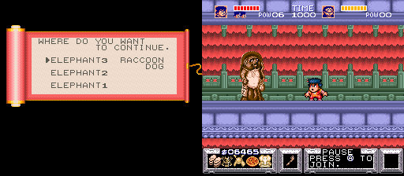
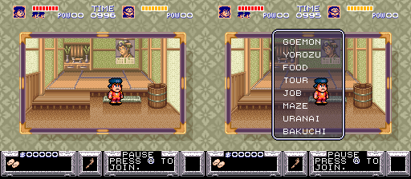
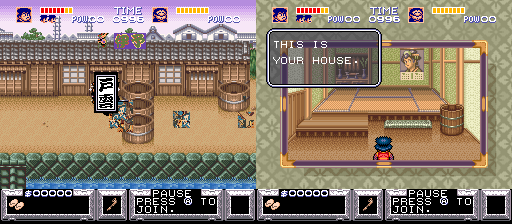
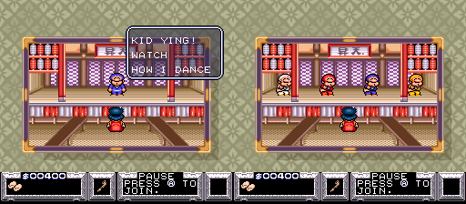

# The Legend of the Mystical Ninja (SNES, USA): passwords and secrets

Everything here comes from disassembling the ROM (`tools/disasm.py`, coverage grown from Mesen 2 code/data
logs via `tools/cdl2entries.py`) and checking the results in Mesen 2 by writing passwords into the logbook
entry buffer and pressing END.

## The logbook password

Code: `$1C:AFC7` (read the entry screen and decode), `$1C:ADB4` (unpack), `$1C:AE4E` (checksum),
`$1C:ACE5` (encode). Tables at `$02:FD3E`-`$02:FDFF`. `mninja.js` reproduces all of it.

- 64 glyphs, each worth 6 bits. Value order (table `$02:FDC2`), with `^` = triangle and `*` = heart:
  `BDGHJQRTVWbdghjqrtvw01234!"^*+=>?@KLMNPXYZ#$klmnpxyz%&56789-/:;<`
- Layout: `[length] [key] [data...] [checksum lo] [checksum hi]`.
  - key = `((c1 ^ $15) - 7) & 63`; it comes from the frame counter when the game writes a logbook, so one
    game state has 63 valid passwords.
  - length = `((c0 ^ $2A) - key) & 63` = number of data chars.
  - data and checksum chars: `((c ^ T[i]) - key) & 63`, T = the bytes at `$02:FD3E`.
  - checksum = 16-bit sum of every decoded field, `& $3F3F`.
- Only four lengths are accepted: **6** and **7** (short codes: 1P / 2P) and **31** and **55** (full logbooks:
  1P / 2P). Fields are packed LSB first, each block padded to a whole char:

| Block | Fields (bits:RAM) |
|---|---|
| short, common | 4:`$82` stage, 2:`$A8` players (bit 0 = P1, bit 1 = P2) |
| short, per player | 1:`$46` 1:`$48` 1:`$4A` 1:`$4C` (the four jutsu) |
| long, common | 4:`$82` stage, 2:`$AA`, 4:`$8E`, 2:`$A8` players, 4:`$19F6` |
| long, per player (P1 at `$1A90`, P2 at `$1B40`) | 16:`$1C` 4:`$1E` 4:`$20` 5:`$22` 4:`$24` 6:`$2A` 5:`$18` 5:`$1A`, 1 each:`$46`-`$4C`, 8 each:`$50 $52 $54 $60 $62 $64 $70 $80 $82 $84`, 1 each:`$90`-`$9A`, 2:`$28` (see the field list below) |

- After the checksum the game also requires stage `$82` < 10 and (long codes) `$8E` < 8. Nothing else is
  range-checked.

### What each field is

Item names are the game's own, from the PROPERTY screen (opened in play with Select/L/R). "Normal
cap" is the limit the game's own code enforces in play; a password can go past it.

| Field | Meaning | Normal cap | Password max | Evidence |
|---|---|---|---|---|
| `$1C` + `$1E` | ryo, 5 BCD digits (`$1E` is the ten-thousands digit) | 99999 (`$05:A3D2`) | 99999; hex digits draw as junk | HUD |
| `$20` | lives (HUD draws at most 4 heads) | | 15 | dying took it 2→1→0, then game over |
| `$22` | health (half-hearts) | max health | 31 | death code `$05:A515` |
| `$18` | max health | 16, +2 per tour package (`$05:A5B3`); reset to 8 every new zone (`$05:9A3A`) | 31 | HUD bar code `$05:9B62` |
| `$1A` | POW = jutsu uses (BCD); using a jutsu costs 1 (`$05:A47B`) | 10 (`$05:A46F`) | 19 | HUD "POW" |
| `$24` | POW pieces (BCD): +1 per pickup (`$03:CC4E`), every 10 → +1 POW (`$05:A44B`) | 9 | 9 (10-15 are not valid BCD) | pause screen number |
| `$2A` | bombs (BCD) | 30 (`$05:A495`) | 39 | PROPERTY "BOMB" |
| `$28` | weapon level 0-2; drops 1 per hit taken (`$05:A548`) | 2 | 3 = coin throw, costs ryo | HUD weapon box |
| `$46 $48 $4A $4C` | jutsu 1-4 learned (pause-screen boxes); cleared every new zone | | | pause screen |
| `$50 $52 $54` | Gold Helmet, Iron Helmet, Straw Hat | | 255 | PROPERTY |
| `$60 $62 $64` | Gold Armor, Chain Armor, Straw Coat | | 255 | PROPERTY |
| `$70` | Straw Sandals = speed (`$05:A62E` caps the effect at 3); you lose 1 when hit | | 255 (no extra effect above 3) | PROPERTY |
| `$80` | Pizza (whole): on death, eaten for a full heal | | 255 | death code `$05:A56B` |
| `$82` | Pizza (slice): on death, +6 health | | 255 | same |
| `$84` | Hamburger: on death, +4 health | | 255 | same |
| `$90` | Pass (the travel pass) | | | HUD key-item slot, PROPERTY |
| `$92` | Text (key item an NPC checks, `$06:EB9B`) | | | PROPERTY |
| `$94 $96 $98 $9A` | Elephant 1-4 (gold statues). The first three set the zone's restart points `$19F0-$19F4` (`$00:AC6D`) for the "WHERE DO YOU WANT TO CONTINUE." menu (see below). Elephant 4 is never read there. Zones 1-3 have no restart points | | | PROPERTY, Mesen |
| `$82` (common) | stage, 0-9 | | 9 | |
| `$A8` | players in the game: bit 0 = P1, bit 1 = P2 | | 3 | |
| `$AA` | players who are out (game over, waiting to continue); a continue clears the bit and sets lives to 2 (`$00:DB39`) | | 3; with Dr. Yang's bit set his empty HUD box shows a prompt ending "A LIFE." instead of "PRESS Ⓐ TO JOIN" | `$00:CC77` |
| `$8E` | story step within the current stage, set by NPC scripts (e.g. `$06:EBB4`, `$03:9DDA`) | 7 (checked) | 7. Loaded 0-7 in every zone: the start never changes; in zone 9 (and the zone 8 slot) 6 and 7 crash | Mesen, 80 loads |
| `$19F6` | first entry of a per-section table (`$19F6,Y`, Y = section × 2) passed to the position routines at `$07:86D0`/`$07:8593` (`$03:ECDF`, `$1C:A0F7`); zone setup zeroes it (`$03:826C`) | | 15; always 0 once play starts, no visible effect | Mesen, 18 loads |

A fresh 1P game starts with 0 ryo, 0 POW, 0 bombs, 2 lives and 8 max health (read from RAM after the
intro). The routine at `$05:9A89` that sets POW 10, 25 bombs and 500 ryo is some other reset, not the
new-game state.

Helmets and armor hold durability, not a count. Armor soaks hits: the damage is subtracted from it
(`$05:A5A4`). The PROPERTY screen shows durability ÷ 8 (gold), 6 (iron/chain) or 4 (straw), rounded up
(table `$01:D0DE`); a password value of 11 in the gold helmet shows as "02". PROPERTY prints counts
as two decimal digits, so 128 hamburgers show as "28".

## GameFAQs codes, checked

| GameFAQs entry | As posted | Result | Working code |
|---|---|---|---|
| Level 1 | `MRbjhj` | OK, stage 0 | same |
| Level 2 | `#rM/B/` | OK, stage 1 | same |
| Level 3 | `8hXwow` | **typo**: `o` is not a glyph | `8hXw0w` (zero) |
| Level 4 | `W:3LNL` | OK, stage 3 | same |
| Level 5 | `K=bPbR` | **typo**: length char wrong | `k=bPbR` (lower-case k) |
| Level 6 | `1tl<H<` | **typo**: checksum fails | `1tL<H<` (capital L) |
| Level 7 | missing | | `/j#2^2` (new, stage 6) |
| Level 8 | `''?kk5k` | OK once `''` is read as one `"` glyph: `"?kk5k`, stage 7 | `"?kk5k` |
| Level 9 | `&xT>X>` | OK, stage 9 (the prison cell, same stage as "Final Level") | same |
| Final Level | `H-WNxN` | OK, stage 9 | same |
| Last level + | `8#4V7 LprBy 4v52B j@7-T YM?0P 7/4By ;` | OK | same |
| Penultimate level + | `¢63>¥ :tH!8 d%w!L 1G¥4M dTH6Q ¥>HLw W` | **typo**: checksum off by 2 | `*63>^ :tH!8 d%W!L 1G^4M dTH6Q ^>HLw W` (capital W, chosen as the likeliest misreading; other one-glyph fixes also pass, all stage 7) |
| Unlimited Hamburgers | `v x Z + + I h : @ ...` | **typo**: `I` is not a glyph | `vxZ++lh:@Ynn3+!$T+KKhG:!<+!+X@r` (lower-case l). Stage 2, 1512 ryo, item `$84` = 128 |

Levels on GameFAQs are numbered by play order: "Level 8" is stage 7 and "Level 9" is stage 9; nobody posted
stage 6 (now `/j#2^2`) or stage 8 (see below). All of the working codes above were loaded in Mesen 2.

## New finds

- **There is no zone 8 start point.** Each stage value picks a start record (`$05:B0D3`). Stage 8 with a
  short code (`/j=2+2`) passes every check but leaves a black screen forever. With a full logbook the
  game starts stage 8 exactly where zone 9 starts (same screen, byte for byte), e.g. the "Last level"
  state with the stage changed: `%>H3Hmq^dWL!D@d&"Hp/w>$>+HTLdJQ`. Full logbooks for stage 0 likewise
  start in zone 2.
- **Two castle starts.** A short zone 9 code (`&xT>X>`) opens in the barred prison cell with a short
  scene. A full zone 9 logbook opens in a white cell with a mesh door (hit the wall to get out). The
  story step doesn't choose between them: full logbooks with story steps 0-5 all start in the white cell.
- **Story steps 6 and 7 crash the castle.** Every zone was loaded with story steps 0-7 (80 loads). No
  start changes in any zone, but zone 9 and the zone 8 slot crash on 6 and 7 (black or garbage screen,
  RAM overwritten). Other zones load normally.
- **Short codes only set the zone.** They also carry the four jutsu bits, but the game clears jutsu as a
  zone starts (`$05:9A3A`); loading short codes with all four set gave none, in zones 2, 5 and 9. Full
  logbooks keep jutsu, the pass and POW (checked in zone 5).
- **Two-player codes.** 7-char and 55-char codes start a 2P game with both players set:
  `:jH204;` (stage 3, both players), and the "Last level" kit for both players:
  `lj/N0<*kM2%mvyMKh0>$JV/Yb0r%*70kM/%#ryNg0t901v/l*01=*Wt`.
- **Weapon level 4.** The 2-bit weapon field allows 3, one more than the game normally gives (the posted
  full-kit codes use 2). Weapon 3 shows a gold-coin icon and the attack throws coins that cost money
  (500 → 476 ryo over a few dozen throws).
- **Out-of-range values show garbage.** Nothing but stage and `$8E` is range-checked, so a code can
  go past every in-game cap (table above): max health 31, POW 19, 39 bombs. The health bar has one
  segment per point of max health: red for health, yellow for the rest. Past 16 it runs over the TIME
  label (20) and up to Dr. Yang's face (31). Health above max draws only max segments; health 0 loads
  alive with an all-yellow bar. Lives above 4 still show 4 heads. BCD fields set to hex digits A-F draw as junk tiles (money, POW, the pause-screen POW
  pieces).
- **"Unlimited Hamburgers" explained.** Hamburgers are a death-save item: when health hits 0 the game
  eats a whole pizza (full heal), else a slice (+6), else a hamburger (+4), and no life is lost
  (`$05:A56B`). The GameFAQs code gives 128 hamburgers. In Mesen, health hitting 0 took the count
  128 → 127 → 126 and gave back 4 health each time, with lives unchanged. The field holds up to 255:
  `b!DQQTnQhTQThQDz*Q991!QD^RBQQvM` (stage 0, 255 hamburgers; loads with 255 in RAM).
- **Max kit.** `b!DQQZ%$"Rt<5JBy+J--04N?+vkJl<J`: stage 0, 99999 ryo, 9 lives, 16/16 health, POW 19,
  39 bombs, weapon 2, all jutsu, 255 of every helmet/armor, 255 whole pizzas, 99 slices, 99
  hamburgers, 3 sandals, pass, text and all four elephants. Loaded in Mesen (HUD shows $99999 and POW19).
- **Dr. Yang alone.** A 31-symbol logbook can hold only player 2 (`$A8` = 2); the game writes these
  after Kid Ying's game over in a 2-player game. Loads with Dr. Yang alone and Kid Ying's box offering to
  join. `$A8` = 0 is accepted too: the game then starts Kid Ying with default stats.
- **The elephants are checkpoints.** Elephants 1-3 each give a restart point in zones 4-9 (zone 4, 6,
  7: one; zone 5 and 9: two; zone 8: three; zones 1-3: none), set at zone start from a per-zone table
  into `$19F0-$19F4` (`$00:AC6D`). When you lose a life, `$00:CBDE` stores the new count, and if `$8C`
  (0 = the zone's town half, 1 = its action stage) isn't 0 it picks mode 24 when any restart point is set
  (`LDY #$18` at `$00:CBF8`, else mode 22, restart the stage). Mode 24 (`$00:A73F`) is a scroll titled
  "WHERE DO YOU WANT TO CONTINUE." with one line per point (ELEPHANT3, ELEPHANT2, ELEPHANT1) plus RACCOON
  DOG (a tanuki: the stage's start); `$00:A79B` reads the choice into `$56` and `$00:A873` restarts there.
  In Mesen, losing a life in zone 8's action stage with all three brought the screen up by itself, and
  each elephant restarted at a different checkpoint. Elephant 4 is never read. A death in town, or a
  time-out there, just respawns you. An ordinary death keeps the flags; a game over clears them. So a
  logbook with elephants set starts you with every checkpoint of that zone already collected.

  
- **Entry screen controls.** B enters a symbol, A or Y deletes one, X does nothing. The cursor starts
  on B, stops at the edges (no wrap), and in the bottom row skips the gap after @ (one press from @ to
  ←). The page's typing guide was checked by typing three codes (6, 31 and 55 symbols) and one ending
  on the bottom row with real button presses in Mesen; all loaded.
- **Length symbol.** The decoder only trusts a length symbol that disagrees with the typed length when
  `$70` ≠ `$1A` or `$72` < 6. On the logbook screen `$70` = `$1A` and `$72` = 6, so a mismatch is always
  rejected (checked with GameFAQs' `K=bPbR`).

### Fuzz check against the real decoder

1,557 logbooks were typed into the real entry screen in Mesen: every one-symbol change of `MRbjhj` and
`:jH204;`, 500 random one-symbol changes of the two "Last level" codes, 240 random strings of each legal
length, and crafted edge cases (zones 10-15, story steps 8-15, zero players, key 0, maxed shared fields).
The game accepted exactly the 13 that `mninja.js` accepts and rejected the other
1,544. Full logbooks take longer than 45 frames to leave the screen, so acceptance was judged per case.

16 more logbooks made by `encode()` with random in-range values (zones 2-9, 1P, 2P and Dr. Yang alone,
random keys and event values) were loaded in Mesen, and every player field in RAM matched: ryo, lives,
health, max health, POW, pieces, bombs, weapon, jutsu, every item count and every key item.

Make your own with the generator page, or `encode()` in `mninja.js`.

## Regions

The USA, USA Virtual Console, Europe and Germany ROMs all use the same logbook code and tables, so a
logbook works in all four. Byte compare against the USA ROM:

- **USA Virtual Console:** 11 bytes differ: the header checksum and 7 bytes of palette data at
  `$09:8E0B` (file `0x48E0B`). Code is identical.
- **Europe:** every changed byte in the logbook routines is a relocated address (the routines sit one
  byte later, `$1C:ACE6` on). Tables at the same place.
- **Germany:** the same relocations, plus the tables moved to `$02:F4AE` (XOR) and `$02:F532` (symbols)
  with identical contents. Menus are German: WEITER → VON LOGBUCHEINTRAG, © 1994.

In Mesen, the "unlimited hamburgers" code and `/j#2^2` loaded with the same zone and RAM on all three.

All four ROMs are version 1.0 in the header, and the USA one matches No-Intro's only US entry (CRC32
`82479D6A`).

### Japan (Ganbare Goemon: Yuki Hime Kyuushutsu Emaki)

Four Japanese ROMs checked (the 1991-05-31 beta was not): 1.0 (`ADDE8D79`), Rev 1 = 1.1 (`830BC11C`),
Rev 2 = 1.2 (`6CD62399`) and Rev 2 Virtual Console (`A7D7E1D5`, 9 bytes from Rev 2: header plus the
same palette patch at `$09:8E0B` as the US VC). The three cartridge revisions differ widely (code moved).

**Same logbook scheme, kana symbols.** The decoder sits in bank `$07` (`$07:B96C` in 1.0, `$07:B973`
in 1.1, `$07:B97A` in 1.2) and matches the US one instruction for instruction except the blank tile
(`$3F` instead of `$40`) and table addresses. Field lists are bit-for-bit the same as the US. All three
revisions share one symbol table (`$02:EFB3` in 1.0, `$02:EFBA` in 1.1/1.2); in value order:

| Values | Symbols |
|---|---|
| 0-4 | あいうえお |
| 5-9 | かきくけこ |
| 10-14 | さしすせそ |
| 15-19 | たちつてと |
| 20-24 | なにぬねの |
| 25-29 | はひふへほ |
| 30-34 | まみむめも |
| 35-37 | やゆよ |
| 38 | わ |
| 39-43 | らりるれろ |
| 44-48 | がぎぐげご |
| 49-53 | ざじずぜぞ |
| 54-58 | だぢづでど |
| 59-63 | ぱぴぷぺぽ |

So a US/European logbook works in Japanese 1.1 and 1.2 symbol for symbol by value (US `B` = value 0 =
あ, and so on).

**1.0 keys some symbols differently.** The XOR keys are the field-list bytes, and 1.0's field list
names different RAM (P1 block at `$1A80`, `$19C6` instead of `$19F6`, items `$60-$94`), so its keys
differ at data symbols 13, 37, 40, 43, 46, 49 and 52 (counting from 0). Short codes (6/7 symbols) are the same in every version; full
logbooks for 1.0 need those symbols re-keyed. A 1.1/1.2 logbook is rejected by 1.0.

**Checked in Mesen:** the "Last level" code converted to kana loaded in 1.2, 1.1 and (re-keyed) 1.0
with stage 9, 6465 ryo, 3 lives, 8/8 health, weapon 2 and 24 gold helmet; `MRbjhj` loaded zone 1 in
1.2 and 1.0; the 55-symbol two-player code loaded both players in 1.2. The Japanese entry screen is
reached with START, right (つづきをあそぶ), START, START, down (たびにっきを つけたところから), START; its
grid is あいうえおやゆよわ / かきくけこらりるれろ / さしすせそがぎぐげご / たちつてとざじずぜぞ /
なにぬねのだぢづでど / はひふへほぱぴぷぺぽ / まみむめも ← → おわり, and pressing right past わ drops to ろ.
B enters a symbol and A or Y deletes one (both checked in Mesen). The page's typing guide moves down first when it needs column 9
from the top row; with that, all 64 kana typed in value order matched the ROM table, and the "Last
level" code (1.2 and 1.0) and the two-player code (1.2) typed with real presses through おわり all
loaded. The game draws the voicing marks on the 3-4 pixel rows above each 8x8 kana, so
`img/font_jp.png` is 8x12 per symbol, cut from the entry screen after typing all 64.

**Content differences seen in Mesen (1.2 against the US):**
- The PROPERTY screen (もちもの) lists うめおにぎり (pickled-plum rice balls) where the US has pizza.
- At the bath house the Japanese attendant asks どちらにはいるのかな？ with おとこゆ / おんなゆ (men's or
  women's bath); the US version goes straight in.
- Not checked: the strip-show room slot, the 1.0 final-boss sprites, the single maze.

## Debug leftovers and unused text

Found by a whole-ROM scan (not just the traced 10%), with "never runs" judged from the union of every
Mesen code/data log taken (title, logbook, all ten stages; no full playthrough, so shops, minigames,
bosses and the ending are only partly covered).

- **Debug room-select menu on controller 2.** Area handler `$05:E356` checks controller 2's newly
  pressed Up (`$2A` bit `$0800`); it sets `$8C` = 2 and `$8E` = `$8001`, and the interior code
  (`$04:96DA`) then opens a menu of romaji room names, four pages of eight (`$02:B4BF`): GOEMON YOROZU
  FOOD TOUR JOB MAZE URANAI BAKUCHI / BANYA OMITSU YANOSUKE NIKKI GAME MOGU KEIBA EAWASE / NAZO ONI SHOW
  HAMBURG YADO DOUJYOU FURO SHICHI / TAKARA PEINT NINKA1 MINKA2 TOUR2 GAIJIN ROUYA. Picking one warps into
  that interior (forced in Mesen: GOEMON gave "THIS IS YOUR HOUSE."). The handler is only listed for
  zone 1 area 2, stages 11-12 area 2 and stages 10 and 13 (per-zone area handlers, table `$01:E217`,
  indexed by `$82` then the area `$8A`); stages 10+ can't be loaded. Same in all four ROMs.

  **Zone 1 area 2 is a test room nobody reaches.** Forcing each zone 1 area in Mesen (overriding `$8A`
  as the logbook loader sets it, `$00:A84E`): 0 Edo, 1 the bamboo action stage, **2 a house room in town
  mode** (tatami, a wall scroll, a tub), 3 the boss, 4 a raccoon-dog scene, 5 Edo at dusk, 6 a green maze.
  In area 2, controller 2's Up opens the room menu. Normal play skips it: a new game's opening stays in
  area 0, the action stage goes from area 1 straight to area 3 (Mesen, walking it with health held up), the
  start-area table (`$01:8CED`) gives zone 1 only areas 0 and 4, and neither door table (`$01:DD8B`,
  `$01:D780`; byte 3 = zone << 4 | area) leads to it. The only other `$8A` writes are the area-to-area
  step (`$05:E9CC`), the return from an interior (`$05:B019`) and the dead menu below.

  
- **Dead hex debug menu `$1C:A277`.** Nothing in the ROM calls it (no JSL, JML or pointer to it). It
  prints rows of hex digits and steps them with the buttons in `$10`: zone `$82` (wrapping 0-9),
  area `$8A`, story step `$8E`, `$AE` (−1 to 1) and bit 0 of `$1FF0`. A developer's zone, area and story
  select, cut off from the game.

  
- **Debug camera flag `$EE`.** `$07:A751` runs every frame from the scroll code but does nothing unless
  `$EE` bit 0 is set, and nothing in the ROM writes `$EE`. Forced on in Mesen: B toggles a mode that
  centres the camera on Kid Ying, and holding Y or A nudges him until the camera is 8-pixel aligned.
- **The Ebisumaru side show.** The room list's SHOW entry (room `$92` = `$0E`) is a show tent that is
  never entered in play: "WELCOME. THIS IS THE S...", "1 PLAY: $100 DO YOU WANT TO WATCH?", "SHOW THEM
  IN.", then Ebisumaru ("KID YING! WATCH NOW: DANCE") and a line of dancers. Reached in Mesen through the
  room menu (set `$8C` = 2, `$92` = 0, `$8E` = `$8001`; A turns the page, B moves the cursor, Y warps); it
  took the 100 ryo and played. The romaji labels "KONO", "FUTARI", "TATE" sit right after its lines.

  
- **No button cheats.** The joypad is read once (`$00:8619`, auto-read; pads 1-3 held at `$20-$24`,
  pressed at `$28-$2C`); every comparison of input against a fixed combination was checked, and none
  is a sequence or cheat. An NPC says as much: "IF YOU USE THE COMMAND "UP UP DOWN DOWN L R L R B A",
  NOTHING WILL HAPPEN." (`$02:F5DC`). No SRAM, no region checks, no "DEBUG"/"TEST"/"SOUND" text.
- **Text.** Plain ASCII (`` ` `` is the apostrophe); dialogue codes `FE` newline, `FD` wait/new page,
  `FA n` substring, `FB` player name, `FF` end. Leftovers: romaji labels "KONO", "FUTARI", "TATE"
  (`$02:BA05`) after the sideshow lines; placeholder strings `-CDE`, `-FGH`, `-IJK`, `-ILK`
  (`$02:CCB6`); an item-name table (`$02:C720`) that also lists CLOCK, SCROLL, BOMBS, LUCKY CAT and 1UP,
  likely shop names. Typos in the shipped text: "PLEAS." (`$02:E238`) and "THEIVES" (`$02:FA7E`).
  Not yet seen in play, so unconfirmed as unused: a rhythm minigame's text ("WHICH COURSE DO YOU WANT?
  SLOW COURSE / FAST COURSE", `$02:AE16`) and "KID YING / DR. YANG / SPEED DOWN / LASER / THE WALL"
  (`$07:B221`), possibly a two-player handicap menu.
- **Compression.** Graphics and tilemaps are LZ-packed with a 1 KB ring buffer (`$00:9F0E`). Stream:
  a u16 length, then `00-7F x` copy (b>>2)+2 bytes from ring position ((b<<8|x)-`$3DF`)&`$3FF`, `80-9F`
  literal run, `A0-BF` (00, literal) pairs, `C0-DF v` fill, `E0-FE` zeros, `FF n` n+2 zeros. `tools/lz.py` implements it, checked
  against Mesen's WRAM. 495 graphics blocks decoded; no clearly unused sprite sheet turned up, and no
  zone 8 start graphics.

## Searched, nothing found

- Button sequences or cheat codes anywhere in the ROM (see above).
- A second joypad read, serial `$4016/$4017` reads, SRAM flags, region or PAL checks.
- RAM flags read but never written, other than `$EE` (not exhaustive over all of RAM).

## Open

- The rhythm-minigame and two-player menu text above: unused or just not reached by the code logs.
- `$19F6` mid-zone: its value when the game writes a logbook inside a section other than 0 is unknown;
  it is zeroed on load either way.
